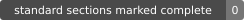

<p align="center">
  
</p>

# surf

**A web browser written from scratch, where the specification comes first.**





surf is a small browser written in Rust. It does not wrap Chromium, WebKit or Gecko, and nothing
that ships depends on a third-party crate. Every behaviour is written down as a specification
before any code exists, and a test suite generated from that specification runs against the
real code on every change.

It is young. Today it loads a page from the command line and tells you what happened. It is
growing into two things:

- a browser that an AI agent drives from the command line, where each call answers in a few
  dense lines of text: where you are, what you can do here, what just changed;
- a fast, repeatable end-to-end test runner that replays what such an agent explored, without
  a server.

## Install

surf comes as one pre-built binary for Linux (x86_64 and aarch64, statically linked) and
macOS (Apple silicon and Intel). Each [release](https://github.com/beyond10x/surf/releases)
has the four archives and a `SHA256SUMS` file.

```console
$ version=0.1.0 target=x86_64-unknown-linux-musl
$ base=https://github.com/beyond10x/surf/releases/download/$version
$ curl -fsSLO $base/surf-$version-$target.tar.gz -fsSLO $base/SHA256SUMS
$ grep " surf-$version-$target.tar.gz\$" SHA256SUMS | sha256sum --check
$ tar -xzf surf-$version-$target.tar.gz
$ sudo install surf-$version-$target/surf /usr/local/bin/surf
```

The other targets are `aarch64-unknown-linux-musl`, `aarch64-apple-darwin` and
`x86_64-apple-darwin`; on macOS use `shasum -a 256 --check`. The macOS binaries are not
signed or notarised. There is no Windows binary yet.

## A first look

```console
$ surf http://127.0.0.1:41977/index.html
navigation f6eef140-16d8-458c-bdfb-8999c52d7b31 Committed http://127.0.0.1:41977/index.html
request f6eef140-16d8-458c-bdfb-8999c52d7b31 Responded http://127.0.0.1:41977/index.html
document 9ed741bc-a98b-428b-9585-c90c379a8e4d http://127.0.0.1:41977/index.html
```

One line per thing that happened, in a format a script can rely on. The exit status says
whether the page loaded. The full output format and the exit statuses are in
[`docs/surf-command.md`](docs/surf-command.md).

This is where it is heading. An agent's answer looks like this; the format exists
(`crates/answer`), the command that prints it arrives with wave 4 of the roadmap:

```text
surf 1 session 7f3a open
did go "http://example.org/login"
page 200 "text/html" "http://example.org/login" "Sign in"
```

## What surf is

- A browser built from first principles. URL parsing, HTTP, HTML parsing and everything after
  them are written here, each against its standard.
- A set of components that share no state. Each keeps its own data, accepts commands and
  publishes events. Nothing reaches into another component's memory.
- A headless tool first. Its first interface is a command line, for people and for agents.
- An experiment: how far does a browser get with no runtime dependencies at all?

## What surf is not

- Not a browser for daily use. There is no window, no rendering, no JavaScript and no `https:`
  yet.
- Not a fork of an existing engine, and not a shell around one.
- Not complete, and it says where. A part of a standard is called complete only when all of it
  is specified and the standard's own tests for it pass. Nothing carries that mark yet, which
  is what the grey badge above means.
- Not in a hurry to grow. A feature is added when a planned step needs it, not because a
  standard lists it.

## Principles

1. **Specification first.** No behaviour exists in code that [`spec/`](spec/) does not state.
   A gap is reported, not filled in quietly.
2. **Complete means complete.** Work stays marked incomplete until it passes the standard's own
   tests. Skipped cases are counted and listed by name.
3. **Isolation over speed.** A component is a security boundary. A design that needs two
   components to share memory is refused.
4. **No third-party code in what ships.** The Rust standard library and the operating system
   are allowed. The checks fail if the lock file lists an outside package. One exception is
   planned: audited cryptographic primitives for TLS.
5. **No unsafe code.** Every hand-written crate forbids it.
6. **Text from the web stays text.** Anything from a page, a server or an address is escaped
   before it is printed, so a page cannot forge a line of surf's output.
7. **A passing test must be able to fail.** Tests are tried against planted defects. A storage
   that drops every write fails 31 of the 81 scenarios.
8. **Small.** A standard is followed for what surf does, not implemented whole.

## What works today

- **A page load, end to end.** `surf <url>` opens a window and a tab, starts a navigation,
  fetches the address over `http:` and creates a document for an HTML response.
- **Six components in one process**: `agent`, `shell`, `navigator`, `net`, `document` and
  `renderer`.
- **Its own HTTP/1.1 client**, with one deadline for the whole exchange (40 seconds at most)
  and hard limits on header and body size.
- **81 specified scenarios**, each passing twice: once against the specification's own
  interpreter and once against the Rust code.
- **324 tests**, built with warnings treated as errors.

New with the third wave of the current plan. Nothing here lets you do something new with the
`surf` binary yet (release `0.1.0` does what it did); these are parts the next waves build on:

- **The daemon, `surfd`.** It keeps the list of sessions (open, closed or died), passes each
  request to the session's own process and the answer back, and exits when it has been idle.
  It is tested against a stand-in session. The session process comes next, so `surf-agent`
  still cannot open a session.
- **The live view's page.** Nine plain files, with no framework, nothing from another origin
  and every value shown as text, fitting screens from 360 px to 1,400 px wide. One command from
  a source checkout, the `prototype` example of the `surf-view` crate, serves it over three
  scripted sessions and prints an address to open in a browser on the same machine. It shows
  example data only; real sessions come with later waves.
- **An agent's actions in the model.** A session keeps a log of what the agent did, in order
  (an `open` with an address is two actions, `open` and `go`), and shows the status, media type
  and failure reason of its navigation. The specification and the Rust code hold both, with
  scenarios.

New with the second wave:

- **Agent sessions in the specification.** The `agent` component keeps the sessions an AI agent
  opens: it can open one, send it to an address, and close it. A session follows its
  navigation from started to committed, failed or cancelled, and closing a session closes its
  tab. The Rust code runs it, and the scenarios hold it.
- **The agent command line, `surf-agent`**: its parser follows the command-line document
  [`cli/surf-agent.yaml`](cli/surf-agent.yaml), the session token is read from the environment
  or a file only you can read, and it talks to a daemon over a Unix socket. That daemon,
  `surfd`, is new with the third wave, but the session process it starts is not there yet, so
  `surf-agent` cannot open a session; its tests run against a stand-in.
- **The live view's web server.** It answers `GET` requests only, from a fixed set of routes,
  checks the `Host` header and a view token, and streams events with a bounded queue per
  reader ([`docs/view-stream.md`](docs/view-stream.md)). Its page is new with the third wave.
- **A test harness for the HTML parser.** It holds 9,107 cases from html5lib-tests and
  web-platform-tests and counts how many a parser passes. The parser is still empty, so today
  it runs 9,095 of them and passes 5, which is one tokenizer test with an empty input.

New with the first wave:

- **A URL parser** following the WHATWG URL Standard. It passes 872 of the 904 cases of the
  cross-browser URL test data. The other 32 need internationalised host names and are listed
  as skipped.
- **The agent answer format**: a renderer and a parser that reads every answer back unchanged,
  tested with 50 hostile values.
- **Secret handling**: random numbers from the operating system, a comparison that does not
  leak where two secrets differ, and the session token.
- **Design notes** for the HTML parser, the scenario runner and the live view.

## Roadmap

The current plan has 58 stories in 22 steps, called waves. Waves 1 to 3 are delivered. The
plan is [`docs/plan/agent-waves.md`](docs/plan/agent-waves.md) and its design is
[`docs/design/agent-interface.md`](docs/design/agent-interface.md).

The next release, `0.2.0`, comes after wave 4. It adds the agent binaries beside `surf`:
`surf-agent`, `surfd` and `surf-session`, for Linux only at first. The steps after it, and the
list after the table, are planned and have no date.

| after wave | what you can do |
|---|---|
| 4 | Drive a session: `surf-agent open`, `go`, `look`, `close`. A daemon keeps the sessions, one process and one token per session. |
| 7 | Watch every session live in a local web page: where it is, what it did, what changed. |
| 11 | Read a real page's links, buttons and form fields, from an HTML parser held to the html5lib tests. |
| 18 | Follow links, fill and submit forms, go back and forward. Each answer says what changed. |
| 22 | Record an agent's session, turn it into a test, and replay it against the recorded network. |

Next after that, wanted and not planned in detail yet:

- **TLS 1.3**, and `https:` with it. Soon: most of the web is not reachable without it.
- **Screenshots.** That takes CSS, layout, painting and text rendering, all written here.
- **A JavaScript engine**, built from first principles as a project of its own that surf
  embeds.
- One operating-system process per component.
- The Chrome DevTools Protocol, so existing test tools can drive surf.

## How it is built

The design lives in [`spec/`](spec/) as an [ESS](https://github.com/beyond10x/ess)
specification. `ess` generates the components from it into
[`generated/rust/`](generated/rust/), and generates the scenarios that hold the code to it.
Hand-written crates under [`crates/`](crates/) supply what the generated code leaves open:
talking to the network, keeping each component's data, and the command line.

| component | what it does |
|---|---|
| `agent` | the sessions an AI agent opens and drives from the command line |
| `shell` | the windows and tabs the user sees and acts on |
| `navigator` | decides what each tab loads and tracks every load to its end |
| `net` | fetches resources; the only component that talks to the network |
| `document` | parses response bodies into documents |
| `renderer` | styles, lays out and paints a document into a frame (specified, not rendering yet) |

To build surf from source you need [`ess`](https://github.com/beyond10x/ess) 0.96.0,
[`task`](https://taskfile.dev) and a Rust toolchain (built with 1.99.1); `task build` builds
the binary. That is for working on surf, not for using it.

One command checks everything:

```console
$ task check
surf v1 — 9 file(s), 7 scenario(s), valid
81 scenario(s) (7 authored), 27 refusal(s), written to .out/suite.json
  81 scenarios: 81 passed, 0 failed, 0 error, 0 unsupported
81 scenario(s) (7 authored), 27 refusal(s), written to .out/suite.json
  81 scenarios: 81 passed, 0 failed, 0 error, 0 unsupported
the interpreter and the Rust system ran 81 scenario(s) each, of suite sha256:52cfd52d0708126b94c22777a19f089867264b0f44b14813330565e8079ea9b7
generated/rust matches spec/ (30 artifact(s) and .ess-output)
cli/surf-agent.yaml — valid CLI presentation binding
Cargo.lock: 20 package(s), none from outside this repository
    Finished `dev` profile [unoptimized + debuginfo] target(s) in 0.00s
88 test suites: 324 passed, 0 failed, 0 ignored
```

It validates the specification, runs the 81 scenarios against the interpreter built into `ess`
and against the Rust code, checks that the generated code still matches the specification and
that the lock file holds no outside package, then builds and tests. The scenario runner in
[`conformance/`](conformance/) is the one place a third-party crate is used; nothing that
ships depends on it.

`task open` lists the design questions that are still open.

## Where things are

| path | what it holds |
|---|---|
| [`spec/`](spec/) | the specification |
| [`generated/rust/`](generated/rust/) | the components, generated from `spec/`, never edited by hand |
| [`crates/`](crates/) | the hand-written crates |
| [`conformance/`](conformance/) | the runner that holds the Rust code to the scenarios |
| [`docs/surf-command.md`](docs/surf-command.md) | the `surf` command: output format, exit statuses, limits |
| [`docs/design/`](docs/design/) | accepted designs |
| [`docs/plan/`](docs/plan/) | the plans, their waves and reviews |
| [`AGENTS.md`](AGENTS.md) | the working rules, written for the coding agents that build surf |

The badges at the top are files in this repository ([`docs/badges/`](docs/badges/)), written
from the numbers `task check` prints. They are not fetched from a service.

## Licence

Apache-2.0: see [`LICENSE`](LICENSE) and [`NOTICE`](NOTICE). You may use, change and share surf.
If you do, keep the notice and say where it came from: beyond10x, this repository.
